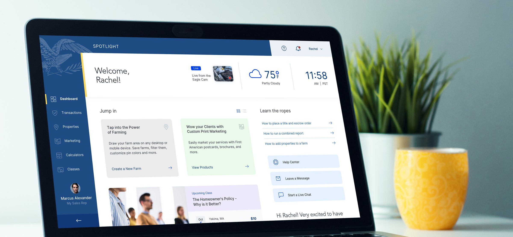
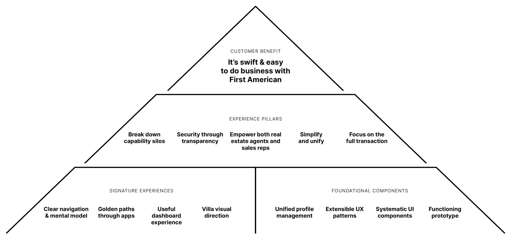
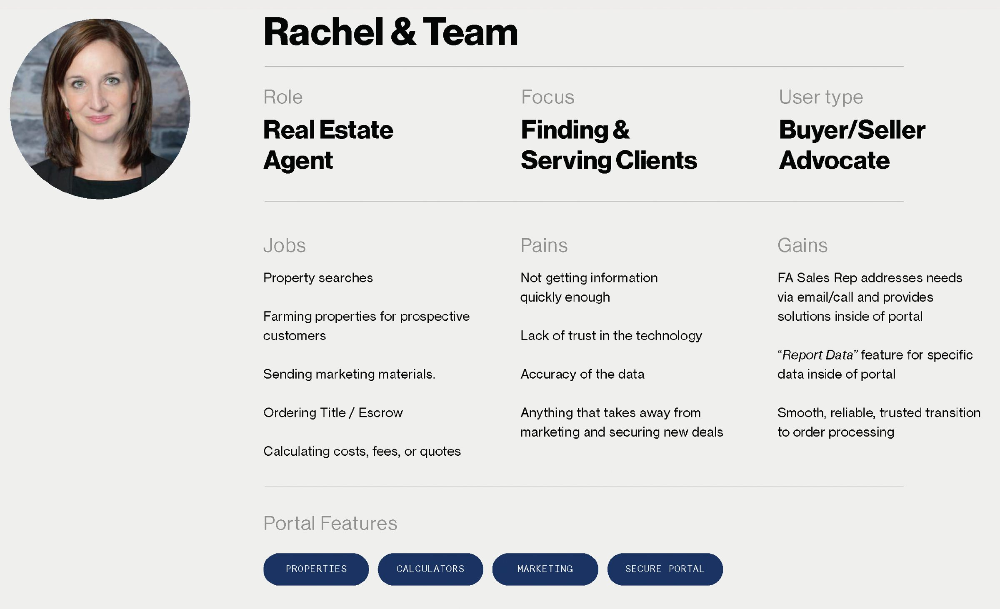
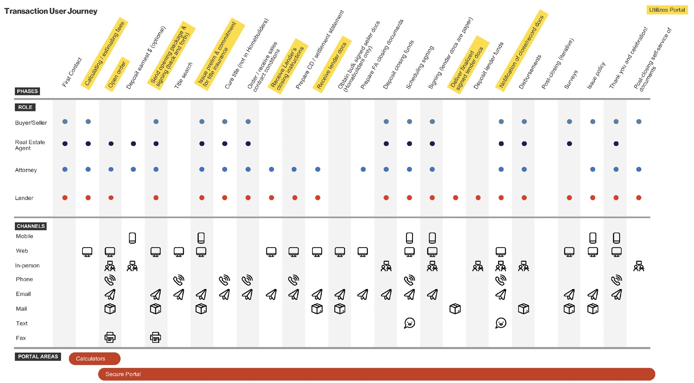
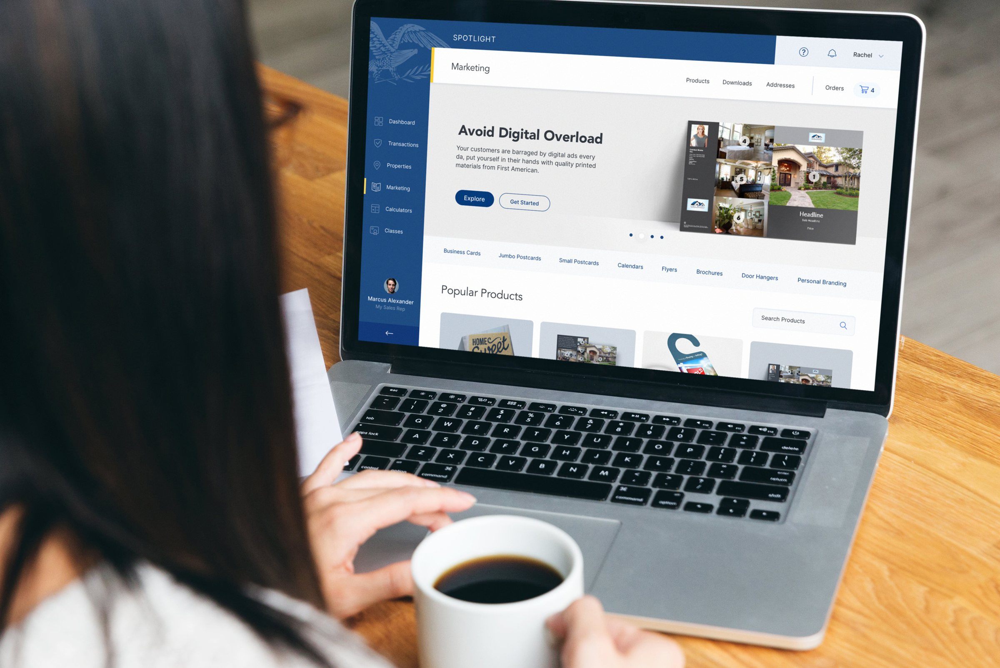
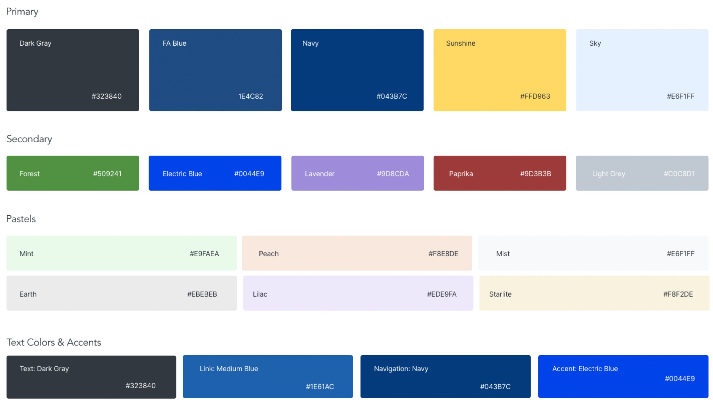

# IgniteRE — UX case study

A UX case study by **Suvarna Myneni**, UX/UI designer on FirstAm IgniteRE (the portal is named SPOTLIGHT in the interface).

IgniteRE is a mobile-friendly platform for residential real estate transactions. It gives professionals one sign-on to share transaction details, look up property data, create marketing materials, and take part in education. The project document calls it a Gold Stevie Award winner and records Gold at The American Business Awards in the Real Estate Management Solution category.

The page walks the design process with the work that is actually in the project file: framework, foundations, personas, the transaction journey, information architecture, patterns, key screens, and the design system. It does not add research counts, quotes, timelines, or team details the file does not contain.

**Contact:** [LinkedIn](https://www.linkedin.com/in/suvarnamyneni/)

## View it

Open `index.html` in a browser. No build step.

GitHub Pages can serve this repo from the `main` branch, root folder. When Pages is enabled, the site is:

https://suvarnamyneni-project.github.io/igniteRE-case-study/

## The process

1. **Overview** — the product, the UX/UI role, and the tools (Sketch, Figma, InVision, Miro)
2. **Problem** — design system, global navigation, quick win, brand expression, core capabilities
3. **Discover** — the UX framework
4. **Define** — intent, purpose, and three design principles
5. **Personas** — Rachel & Team, Lance, and Angela
6. **Journeys** — the transaction, by role, channel, and portal area
7. **Information architecture** — global navigation
8. **Patterns** — eleven UX patterns
9. **UI** — Marketing, Properties, Classes, Transactions, sign-in, and the email template
10. **Design system** — dashboard components, iconography, and color
11. **Responsive** — web, tablet, and phone
12. **Results** — 40% more design consistency, 30% fewer redundancies, 25% faster delivery, and the Gold award
13. **Reflection** — what the artifacts show, and what the file leaves open

## Key visuals

## Notes

`NOTES-for-Suvarna.md` lists details the source file does not include (research method, testing, timeline, and a few labels to confirm). It is a working checklist, not part of the case study page.
